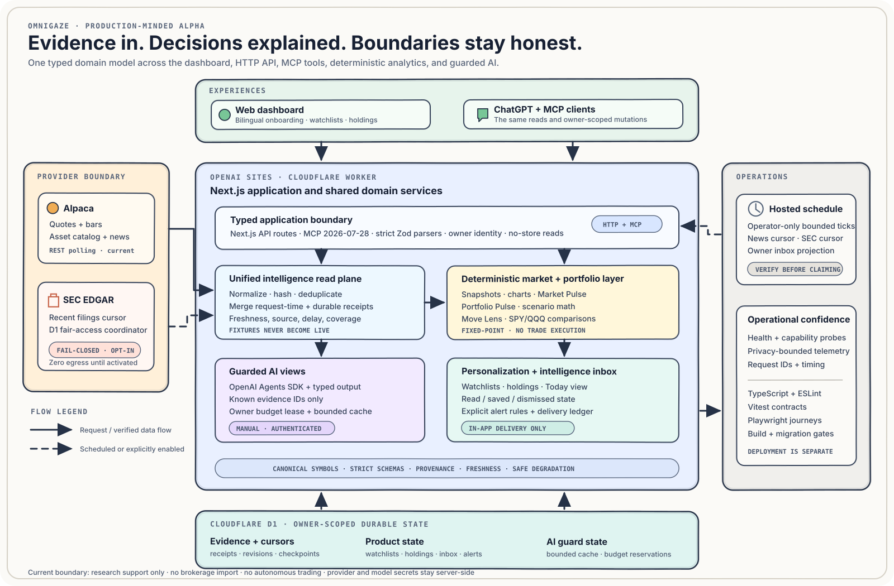

<div align="center">
  

  <h1>Omnigaze</h1>

  <p><strong>Evidence-first market intelligence, personalized to what you follow and own.</strong></p>
  <p>Track the market. Understand the context. Inspect the evidence. Ask better questions.</p>

  <p>
    <a href="https://omnigaze.perkyaisle4.chatgpt.site"></a>
    <a href="https://github.com/jonxsong/omnigaze/actions/workflows/ci.yml"></a>
    
    
    
  </p>

  <p>
    <a href="https://omnigaze.perkyaisle4.chatgpt.site"><strong>Open the live beta</strong></a>
    · <a href="docs/architecture.md">Architecture</a>
    · <a href="docs/product-status.md">Product status</a>
    · <a href="https://omnigaze.perkyaisle4.chatgpt.site/data-and-deletion">Data controls</a>
  </p>
</div>

> [!IMPORTANT]
> **Omnigaze is currently in controlled beta.** The core product is deployed and its release gates are green, but provider access, scheduled collection, alert delivery, and operational support remain intentionally bounded. Wider commercial-launch work is deferred until the beta experience is proven.

## See the market through evidence, not noise

Omnigaze is a bilingual, personalized market-intelligence workspace for active U.S. equities. It brings a user's watchlist, holdings, timestamped market data, licensed news, deterministic portfolio math, and evidence-grounded AI into one research cockpit.

It is designed around a simple rule: **facts, calculations, inferences, and unknowns must remain visibly different things.** Every market surface carries source, freshness, delay, and fallback metadata. AI can interpret captured evidence, but outputs are rejected when they cite evidence IDs outside the supplied set; the model cannot place trades or quietly turn uncertainty into an order.

## What is inside

| Personalized workspace | Market intelligence |
| --- | --- |
| Search the active U.S. equity catalog, build watchlists, record holdings and cost basis, and keep state across sessions. | Inspect provider-backed quotes, chart history, licensed news, Market Pulse ETF proxies, and a deterministic SPY/QQQ Move Lens. |
| **AI with receipts** | **Durable research workflow** |
| Generate a cited Omnigaze View or cross-watchlist Daily Brief from eligible evidence, with visible coverage, uncertainty, and model provenance. | Save, read, and dismiss intelligence events; configure explicit in-app alert rules; export or erase owner-scoped saved data. |
| **English + 中文** | **Browser + API + MCP** |
| One persisted language preference spans the landing page, onboarding, dashboard, inbox, briefs, and research views. | The dashboard, HTTP APIs, and MCP tools share the same owner-safe domain services and validation contracts. |

### The daily loop

1. **Personalize** — finish onboarding, search symbols, add them to a watchlist, and record positions.
2. **Observe** — load bounded provider data with explicit timestamps, coverage, delay, and fallback labels.
3. **Understand** — review Today, the intelligence timeline, Portfolio Pulse, Market Pulse, and Move Lens.
4. **Investigate** — ask Omnigaze for a structured, evidence-cited interpretation or Daily Brief.
5. **Act on knowledge, not orders** — save research, tune in-app alert rules, and explore deterministic scenarios without brokerage execution.

## Architecture

[](docs/architecture.md)

The same domain contracts flow through the React client, HTTP routes, and MCP server. Provider-specific payloads stop at the ingestion boundary; normalized observations, owner state, AI guardrails, and operational coordinators live behind Cloudflare Worker service boundaries.

Read the detailed [architecture, trust boundaries, and failure model](docs/architecture.md).

## Controlled beta status

| Area | Beta status |
| --- | --- |
| Public experience | Live on OpenAI Sites with a startup landing page, onboarding, responsive dashboard, and English/Chinese presentation. |
| Market data | Request-time Alpaca catalog, quotes, historical bars, and licensed news with honest freshness and fallback metadata. |
| AI research | Manual, authenticated, evidence-constrained Omnigaze Views and Daily Briefs with durable budgets and caches. |
| Personal data | Owner-scoped D1 watchlists, holdings, inbox state, alert rules, bounded JSON export, and guarded deletion. |
| MCP | 21 tools span browser-parity research and personal workflows plus closed operator actions; a deployed connection may require reauthorization. |
| Verification | 799 unit tests and 52 browser journeys passed in the latest controlled-beta release gate. |
| Scheduled operations | Cursor engines are implemented; unattended ingestion and owner projection are not claimed until hosted schedules complete a verified tick. |
| SEC filings | Adapter, Fair Access coordinator, and durable cursor are implemented but production egress remains disabled pending a monitored contact identity and explicit activation. |
| Trading | No brokerage import, order routing, or autonomous execution. Omnigaze is research support, not investment advice. |

See the living [shipped-capability checklist and beta milestones](docs/product-status.md).

## Engineering highlights

- **End to end:** responsive product UI, server APIs, AI agents, MCP, data pipelines, persistence, migrations, tests, CI, observability, and deployment.
- **Evidence integrity:** normalized event identities, content hashes, correction-aware revisions, point-in-time timestamps, and durable receipt fallback.
- **Deterministic finance math:** scaled integers and `BigInt` micro-units prevent floating-point drift across holdings, P&L, concentration, and scenario calculations.
- **Fail-closed AI:** strict Zod outputs, evidence-ID grounding, model-aware caching, atomic owner budgets, cross-isolate leases, and no raw prompt storage.
- **Provider resilience:** D1 database-clocked admission, separate capability budgets, shared cooldowns, deadlines, bounded pagination, and explicit degraded states.
- **Privacy by design:** server-derived identity, owner predicates on every personal read/write, no-store personal responses, redacted export, and nonce-bound deletion.
- **Operational clarity:** privacy-bounded telemetry, correlated request IDs, health/readiness contracts, append-only migrations, and locked CI gates.

## Stack

| Layer | Technology |
| --- | --- |
| Product UI | Next.js 16, React 19, TypeScript 5.9, Tailwind CSS 4, Framer Motion, Recharts |
| Runtime | Vinext, Cloudflare Workers, OpenAI Sites |
| Data | Cloudflare D1, Drizzle ORM, append-only SQL migrations |
| Market intelligence | Alpaca market data, active-equity catalog, historical bars, and licensed news |
| AI | OpenAI Agents SDK, Zod structured outputs, evidence-grounded service layer |
| Agent interface | Model Context Protocol `2026-07-28` at `POST /mcp` |
| Quality | Vitest, Playwright, ESLint, TypeScript, GitHub Actions |
| Package manager | pnpm 11.25 |

## Repository map

```text
app/
  api/                 Browser-facing APIs and provider-safe boundaries
  mcp/                 Stateless MCP JSON-RPC endpoint
components/            Landing, onboarding, dashboard, and research UI
db/                    Drizzle schema and D1 access
drizzle/               Reviewed append-only migrations
lib/
  ai/                   Evidence-constrained agents and output gates
  intelligence-inbox/   Durable projection, owner state, and alert rules
  portfolio/            Decimal-safe contracts and deterministic scenarios
  pipeline/             Ingestion contracts and deduplication
  providers/            Market, news, and filing adapters
  repositories/         Owner-scoped persistence
  services/             Shared browser/API/MCP domain services
tests/                  Domain, API, MCP, migration, and browser contracts
docs/                   Architecture, operations, and product status
```

## Run it locally

Requirements: **Node.js 22.13+** and **pnpm 11.25+**.

```bash
git clone https://github.com/jonxsong/omnigaze.git
cd omnigaze
pnpm install
pnpm db:migrate:local
pnpm dev
```

The portable Sites runtime serves at `http://127.0.0.1:5173` by default. Copy `.env.example` for local configuration and keep every credential out of source control.

### Release gates

```bash
pnpm typecheck
pnpm lint
pnpm test
pnpm build
pnpm db:migrate:local
pnpm test:e2e
```

| Gate | Latest verified result |
| --- | ---: |
| TypeScript | Passed |
| ESLint | Passed |
| Vitest | 105 files · 799 tests passed |
| Production Worker build | Passed |
| Local D1 migration reconciliation | Passed |
| Playwright | 52 browser journeys passed |

[View the GitHub Actions history](https://github.com/jonxsong/omnigaze/actions/workflows/ci.yml).

After a schema change, run `pnpm db:generate` followed by `pnpm db:migrate:local`. Applied migrations are immutable: append a new migration instead of editing one that has already shipped.

<details>
<summary><strong>MCP tool surface</strong></summary>

### Research and market reads

- `search_symbols`
- `get_market_snapshot`
- `get_market_context`
- `get_move_lens`
- `get_intelligence_feed`
- `get_omnigaze_view`
- `get_daily_brief`
- `get_provider_status`

### Personalized reads and writes

- `get_watchlist_dashboard`
- `update_watchlist`
- `get_intelligence_inbox`
- `update_intelligence_inbox_item`
- `get_alert_rules`
- `put_alert_rule`
- `get_portfolio`
- `put_portfolio_holding`
- `get_portfolio_pulse`
- `get_decision_support`

### Closed operator tools

- `run_intelligence_ingestion_tick`
- `run_sec_filing_ingestion_tick`
- `run_intelligence_projection_tick`

Use `server/discover`, `tools/list`, and `tools/call` with MCP version `2026-07-28`.

</details>

<details>
<summary><strong>Core data-integrity rules</strong></summary>

- Every quote includes provider, observation time, delay, and market-session metadata.
- `publishedAt` and `observedAt` remain separate to preserve point-in-time truth.
- Replayed events are idempotent; provider corrections retain stable identity and revision history.
- Demo or stale evidence cannot silently enter the durable inbox, create an alert, unlock AI, or produce numeric decision scenarios.
- Missing quotes remain explicit exclusions rather than zero-valued positions.
- AI output schemas contain no trade target, order, or autonomous share-quantity instruction.
- A related event is context, not proof that it caused a price movement.
- Alpaca-backed egress acquires a shared D1 admission before provider work and stores no owner or IP identity.
- Personal records are owner-filtered at the repository boundary and use optimistic conflict protection where applicable.

</details>

## Beta boundaries

- Market data uses resilient REST requests; sub-minute streaming infrastructure is future work.
- Request-time news is available now. Continuous background ingestion and offline inbox materialization wait for verified hosted schedules.
- Alert delivery is currently inside the Omnigaze inbox; email, SMS, push, and browser notifications are not enabled.
- Market Pulse uses honestly labeled ETF prices as proxies, not underlying index levels, yields, volatility measures, or spot commodities.
- Move Lens reports deterministic relative movement, not causal attribution, a forecast, or a trading signal.
- AI runs only after an authenticated, explicit request and fails closed when fresh eligible evidence is unavailable.
- SEC production egress remains disabled until its identity, activation, and monitoring requirements are satisfied.
- The saved-data download is a bounded, redacted snapshot—not a complete platform archive.
- Omnigaze does not import brokerage accounts, place orders, or provide individualized investment advice.

Wider commercial-launch work—including streaming, verified unattended collection, external notifications, expanded operations, and provider/licensing review—is intentionally deferred until the controlled beta has produced enough real usage evidence.

## Trust surfaces

- [Privacy](https://omnigaze.perkyaisle4.chatgpt.site/privacy)
- [Terms](https://omnigaze.perkyaisle4.chatgpt.site/terms)
- [Data export and deletion](https://omnigaze.perkyaisle4.chatgpt.site/data-and-deletion)
- [Scheduled-ingestion contract](docs/scheduled-ingestion.md)

---

<div align="center">
  <strong>Omnigaze</strong><br />
  Built to make market research more inspectable, personal, and honest about uncertainty.
</div>
