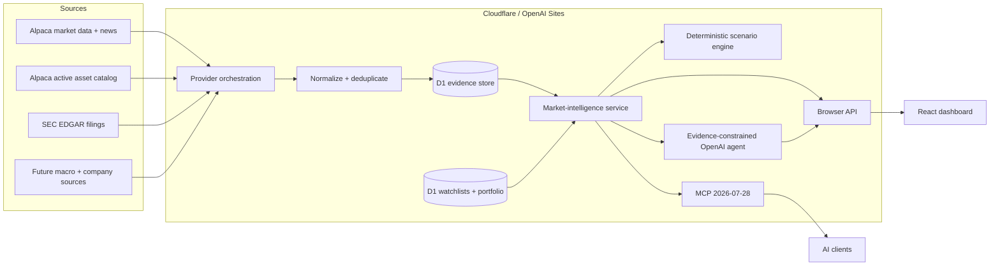

# Omnigaze architecture

Omnigaze uses one domain contract across the browser, HTTP APIs, AI analysis, and MCP. Provider-specific payloads stop at the ingestion boundary; nothing downstream needs to know whether a fact came from Alpaca, SEC EDGAR, or a future provider.

## Trust boundaries

- Provider credentials and the OpenAI API key exist only as encrypted server secrets.
- Browser clients receive normalized data plus explicit source, timestamp, delay, and freshness metadata.
- AI analysis can cite only evidence IDs supplied by the server and is never treated as an order or recommendation.
- Price zones and share quantities come from deterministic, versioned scenario math. The model can explain supplied evidence, but its schema has no target-price, quantity, or confidence fields.
- Numeric scenarios are suppressed when quotes are demo, stale, invalid, or lack corroborating evidence. Confidence means evidence coverage—not the probability of a return.
- User identity is derived at the server boundary; callers cannot choose an `ownerId`.
- Anonymous onboarding is versioned and device-local. Authenticated holdings use owner-scoped D1 rows with optimistic version checks; a sign-in merge must never silently overwrite positions.
- Raw provider payloads are retained for auditability, while corrected events are appended rather than silently overwritten.

## Failure model

The application degrades by capability. A quote-provider outage can leave the evidence feed available; an AI outage can leave deterministic market data available. Fixture fallback is always labeled `demo` and must never be presented as live data.

Historical charts fail independently from current snapshots. If provider history is unavailable, the dashboard labels any bundled series as illustrative instead of blending it with live bars. Asset-catalog refresh can serve a bounded stale catalog, but an upstream outage never creates fake search results.

## Personalization flow

1. The onboarding client collects tracked symbols, owned quantities, optional cost basis, horizon, goals, risk comfort, and liquidity preferences.
2. The asset catalog resolves ticker/name searches to canonical exchange-qualified IDs before persistence.
3. Quantities and costs cross API boundaries as decimal strings and are stored as scaled integers, avoiding floating-point drift.
4. The personalized dashboard joins watchlists, holdings, fresh market observations, and evidence events without requiring an order or brokerage connection.
5. “Ask Omnigaze” receives only the user-approved scenario, normalized evidence, and deterministic math. Its narrative is validated for citations and non-prescriptive language before display.

## Delivery gates

Every pull request typechecks, lints, runs deterministic domain/MCP tests, and builds the production Worker from the locked dependency graph. Deployment is separate from verification so a green build never implicitly publishes.
