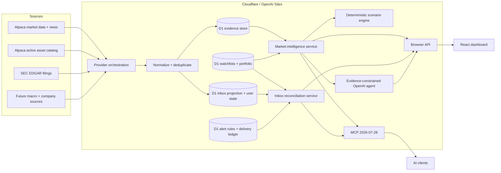

# Omnigaze architecture

Omnigaze uses one domain contract across the browser, HTTP APIs, AI analysis, and MCP. Provider-specific payloads stop at the ingestion boundary; nothing downstream needs to know whether a fact came from Alpaca, SEC EDGAR, or a future provider.

## Trust boundaries

- Provider credentials and the OpenAI API key exist only as encrypted server secrets.
- Browser clients receive normalized data plus explicit source, timestamp, delay, and freshness metadata.
- AI analysis can cite only evidence IDs supplied by the server and is never treated as an order or recommendation.
- Price zones and share quantities come from deterministic, versioned scenario math. The model can explain supplied evidence, but its schema has no target-price, quantity, or confidence fields.
- Numeric scenarios are suppressed when quotes are demo, stale, invalid, or lack corroborating evidence. Confidence means evidence coverage—not the probability of a return.
- User identity is derived at the server boundary; callers cannot choose an `ownerId`.
- Anonymous onboarding is versioned and device-local. Authenticated holdings use owner-scoped D1 rows with optimistic version checks; a sign-in merge must never silently overwrite positions.
- Authenticated inbox and alert-rule writes are owner-scoped and compare both user-state versions and event revisions. Exact retries return the current state; conflicting stale writes do not overwrite newer data.
- Raw provider payloads are retained for auditability, while corrected events are appended rather than silently overwritten.

## Failure model

The application degrades by capability. A quote-provider outage can leave the evidence feed available; an AI outage can leave deterministic market data available. Fixture fallback is always labeled `demo` and must never be presented as live data.

Historical charts fail independently from current snapshots. If provider history is unavailable, the dashboard labels any bundled series as illustrative instead of blending it with live bars. Asset-catalog refresh can serve a bounded stale catalog, but an upstream outage never creates fake search results.

The intelligence inbox also degrades independently. If a provider fails or returns demo data, Omnigaze skips persistence and alert evaluation. A successful live check that cannot prove event freshness may record activation/check metadata, but it persists no stale event or alert delivery. Every degraded path returns the existing durable inbox with explicit sync metadata and never replaces saved research with fixtures.

`GET /api/health` remains a liveness response but reports `status: degraded` unless both provider checks and the required D1 inbox schema markers are ready. The schema probe reads metadata only, exposes no rows or binding details, and catches a missing migration before authenticated traffic reaches the inbox.

## Durable intelligence inbox

The inbox separates a normalized global event projection from private user state:

- `inbox_events` and `inbox_event_symbols` retain stable provider-scoped identities, content hashes, revisions, evidence metadata, and canonical symbol mappings.
- `inbox_event_states` stores owner-scoped read revision, saved/dismissed timestamps, first/last seen timestamps, and an optimistic version.
- `inbox_sync_gates` provides an owner-scoped atomic lease, refresh window, and durable catch-up flag so concurrent Worker isolates do not fan out duplicate provider reads.
- `alert_rules` contains explicit per-owner, per-symbol opt-ins. Rules default to disabled and are never inferred from onboarding answers.
- `alert_deliveries` has a unique owner/rule/event/revision key, making at-least-once provider replay safe without duplicate in-app deliveries.

On the first successful live sync, current history is materialized as read and does not trigger a backlog. Later fresh live events are reconciled idempotently. Freshness is evaluated per item from the later valid value of `publishedAt` and `providerUpdatedAt`; one new article cannot pull stale history into persistence, while a genuine correction to an older article remains eligible. A provider correction increments the event revision without erasing the user’s saved or dismissed state; if the user read an earlier revision, the API exposes `hasUpdate`.

This alpha evaluates the inbox when an authenticated client requests or refreshes it. A D1 lease coalesces concurrent refreshes across isolates; completed checks are reused for 30 seconds, while a bounded catch-up queue may continue every two seconds. “Delivery” means a matching event is available inside Omnigaze; there is no email, SMS, push, browser-notification, or continuously running background delivery claim.

### HTTP and MCP parity

| Surface | Purpose |
| --- | --- |
| `GET /api/intelligence/inbox` | Reconcile eligible live evidence and return durable items, counts, rules, and honest sync metadata. |
| `GET /api/intelligence/inbox/{eventId}` | Read one exact owner-scoped durable item without initiating another provider reconciliation. |
| `PATCH /api/intelligence/inbox/{eventId}` | Atomically update read, saved, and dismissed state with user-state and event-revision checks. |
| `GET /api/alerts/rules` | List tracked-symbol rules, including virtual disabled defaults. |
| `PUT /api/alerts/rules/{symbol}` | Create or replace one explicit in-app rule with optimistic versioning. |
| MCP `get_intelligence_inbox` | Read the same authenticated inbox contract from an AI client. |
| MCP `get_alert_rules` | Read the same authenticated alert-rule contract from an AI client. |

## Personalization flow

1. The onboarding client collects tracked symbols, owned quantities, optional cost basis, horizon, goals, risk comfort, and liquidity preferences.
2. The asset catalog resolves ticker/name searches to canonical exchange-qualified IDs before persistence.
3. Quantities and costs cross API boundaries as decimal strings and are stored as scaled integers, avoiding floating-point drift.
4. The personalized dashboard joins watchlists, holdings, fresh market observations, and evidence events without requiring an order or brokerage connection.
5. “Ask Omnigaze” receives only the user-approved scenario, normalized evidence, and deterministic math. Its narrative is validated for citations and non-prescriptive language before display.

## Delivery gates

Every pull request typechecks, lints, runs deterministic domain/MCP tests, builds the production Worker, reconciles a local D1 schema, and exercises the end-to-end Playwright journeys from the locked dependency graph. Deployment is separate from verification so a green build never implicitly publishes.
