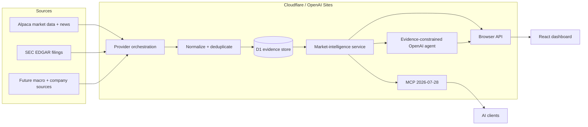

# Omnigaze architecture

Omnigaze uses one domain contract across the browser, HTTP APIs, AI analysis, and MCP. Provider-specific payloads stop at the ingestion boundary; nothing downstream needs to know whether a fact came from Alpaca, SEC EDGAR, or a future provider.

## Trust boundaries

- Provider credentials and the OpenAI API key exist only as encrypted server secrets.
- Browser clients receive normalized data plus explicit source, timestamp, delay, and freshness metadata.
- AI analysis can cite only evidence IDs supplied by the server and is never treated as an order or recommendation.
- User identity is derived at the server boundary; callers cannot choose an `ownerId`.
- Raw provider payloads are retained for auditability, while corrected events are appended rather than silently overwritten.

## Failure model

The application degrades by capability. A quote-provider outage can leave the evidence feed available; an AI outage can leave deterministic market data available. Fixture fallback is always labeled `demo` and must never be presented as live data.

## Delivery gates

Every pull request typechecks, lints, runs deterministic domain/MCP tests, and builds the production Worker from the locked dependency graph. Deployment is separate from verification so a green build never implicitly publishes.
