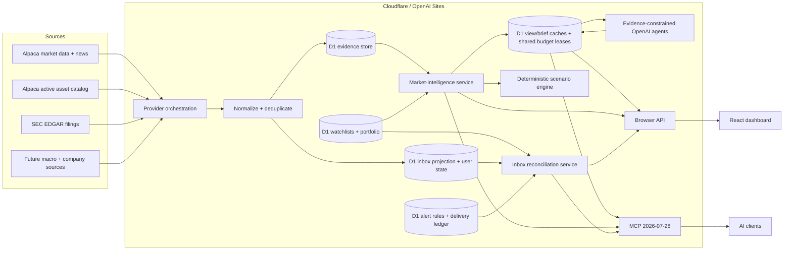

# Omnigaze architecture

Omnigaze uses one domain contract across the browser, HTTP APIs, AI analysis, and MCP. Provider-specific payloads stop at the ingestion boundary; nothing downstream needs to know whether a fact came from Alpaca, SEC EDGAR, or a future provider.

## Trust boundaries

- Provider credentials and the OpenAI API key exist only as encrypted server secrets.
- Browser clients receive normalized data plus explicit source, timestamp, delay, and freshness metadata.
- AI analysis can cite only evidence IDs supplied by the server and is never treated as an order or recommendation.
- AI generation is manual and authenticated. A fail-closed D1 guard keys single-stock output by canonical symbol, prompt version, effective model, and stable evidence revisions. The owner-scoped Daily Brief key also commits to the exact watchlist and UTC date. Volatile response timestamps are excluded; cached JSON is bounded and rejects raw prompts, messages, credentials, headers, tokens, and provider payloads.
- Model work requires an atomic owner-scoped reservation. The default policy permits 20 generation attempts per UTC day, 5 per rolling minute, and 2 concurrent leases. Active cross-isolate retries cannot invoke the model twice; an expired lease may be reclaimed with a new reservation identity, so stale completion cannot finalize it.
- Price zones and share quantities come from deterministic, versioned scenario math. The model can explain supplied evidence, but its schema has no target-price, quantity, or confidence fields.
- Numeric scenarios are suppressed when quotes are demo, stale, invalid, or lack corroborating evidence. Confidence means evidence coverage—not the probability of a return.
- User identity is derived at the server boundary; callers cannot choose an `ownerId`.
- Anonymous onboarding is versioned and device-local. Authenticated holdings use owner-scoped D1 rows with optimistic version checks; a sign-in merge must never silently overwrite positions.
- Authenticated inbox and alert-rule writes are owner-scoped and compare both user-state versions and event revisions. Exact retries return the current state; conflicting stale writes do not overwrite newer data.
- The durable collection ledger retains a minimal, redacted provider envelope plus content digests and revision timestamps; it never stores credentials, request headers, cursor tokens, or article bodies. Corrected events preserve stable provider identity and revision history rather than silently replacing user state.

## Failure model

The application degrades by capability. A quote-provider outage can leave the evidence feed available; an AI outage can leave deterministic market data available. Fixture fallback is always labeled `demo` and must never be presented as live data.

Historical charts fail independently from current snapshots. If provider history is unavailable, the dashboard labels any bundled series as illustrative instead of blending it with live bars. Asset-catalog refresh can serve a bounded stale catalog, but an upstream outage never creates fake search results.

The intelligence inbox also degrades independently. If a provider fails or returns demo data, Omnigaze skips persistence and alert evaluation. A successful live check that cannot prove event freshness may record activation/check metadata, but it persists no stale event or alert delivery. Every degraded path returns the existing durable inbox with explicit sync metadata and never replaces saved research with fixtures.

AI analysis also degrades independently. Cache and budget reads fail closed before model invocation; cache hits and same-isolate followers spend no additional model budget. A single-stock cache lifetime is the earlier of five minutes or the evidence-freshness boundary. A Daily Brief is recomputed whenever its watchlist or selected evidence identity changes and otherwise expires after at most six hours or at the evidence-freshness boundary. Both operations share one atomic owner budget. The durable ledger stores hashed request and operation keys rather than raw model inputs, and bounded cleanup removes expired cache rows plus old reservation history.

## Bilingual application boundary

One client locale provider carries a persisted English/Chinese preference from the landing page through onboarding and the authenticated or anonymous dashboard. The first server render stays deterministic, then hydration applies the saved preference, updates the document language and title, and exposes the same in-product language switch throughout the journey.

Typed, surface-scoped copy dictionaries cover controls, status labels, accessibility text, validation, and safe error states in the dashboard, inbox, Daily Brief, Omnigaze View, and portfolio research workspaces. Dates and numbers use the active locale. Provider names, exchange-qualified tickers, company names, headlines, excerpts, citations, and evidence payloads remain unchanged so localization never alters a source or implies a machine translation. Arbitrary upstream error text is not rendered in Chinese; stable application error codes map to reviewed localized copy instead.

Explicit Daily Brief and Omnigaze View requests carry a strict locale through the browser, HTTP API, service, model prompt, and optional MCP argument. Locale-specific prompt versions isolate durable cache entries, in-flight deduplication, and budget operation identities, so an English result cannot satisfy a Chinese request. Model-authored Chinese fields are checked for Chinese output, grounding, and bilingual non-prescriptive policy both before a cache write and after a cache read; citations and source text remain verbatim.

`GET /api/health` remains a liveness response but reports `status: degraded` unless both provider checks and the required D1 inbox, ingestion, single-stock AI, and Daily Brief guardrail schema markers are ready. The schema probe reads metadata only, exposes no rows or binding details, and catches a missing migration before authenticated traffic reaches a stateful workflow.

### Production telemetry boundary

The alpha emits one structured completion event for every request on five critical boundaries: health, batched market snapshots, single-stock AI analysis, the Daily Brief, and MCP. Logging every completion is intentional and bounded while traffic is at alpha scale; the remaining HTTP routes are not yet represented, and deterministic sampling must be evaluated before expanding this policy to materially higher traffic.

Instrumented responses preserve their existing status, body, cache policy, and application headers while adding a server-generated `X-Request-ID` and a standard `Server-Timing` metric. The request ID is never accepted from an inbound header. An unexpected HTTP failure handled at an instrumented route boundary receives the same opaque ID in its safe response body, response header, unexpected-failure event, and request-completion event. An MCP tool-level failure instead carries its own incident ID in the tool error and matching unexpected-failure event, while the enclosing HTTP exchange retains a separate request-completion ID. Vinext's production-supported `instrumentation.ts` hook reports uncaught render, route, action, and proxy failures outside those wrappers.

Completion events use schema version 1 and contain only `event`, static `operation`, server-generated `requestId`, HTTP `status`, coarse `outcome`, `durationMs`, and `slow`. Static operation labels are length-bounded and syntax-validated at wrapper construction. The telemetry boundary never reads or records URLs, paths, query parameters, request or response bodies, symbols, holdings, owner identity, IP addresses, headers, cookies, credentials, prompts, model output, provider payloads, exception messages or stacks, client idempotency keys, JSON-RPC IDs, or platform request identifiers.

Events go only to the existing Sites/Cloudflare Worker console-log stream. Omnigaze adds no telemetry table, external collector, paid service, or independent retention in this slice; visibility and retention therefore follow the hosting platform's operational-log policy. Server errors are emitted at error level, slow non-server responses at warning level, and other completions at info level.

## Durable intelligence inbox

The inbox separates a normalized global event projection from private user state:

- `inbox_events` and `inbox_event_symbols` retain stable provider-scoped identities, content hashes, revisions, evidence metadata, and canonical symbol mappings.
- `inbox_event_states` stores owner-scoped read revision, saved/dismissed timestamps, first/last seen timestamps, and an optimistic version.
- `inbox_sync_gates` provides an owner-scoped atomic lease, refresh window, and durable catch-up flag so concurrent Worker isolates do not fan out duplicate provider reads.
- `alert_rules` contains explicit per-owner, per-symbol opt-ins. Rules default to disabled and are never inferred from onboarding answers.
- `alert_deliveries` has a unique owner/rule/event/revision key, making at-least-once provider replay safe without duplicate in-app deliveries.

On the first successful live sync, current history is materialized as read and does not trigger a backlog. Later fresh live events are reconciled idempotently. Freshness is evaluated per item from the later valid value of `publishedAt` and `providerUpdatedAt`; one new article cannot pull stale history into persistence, while a genuine correction to an older article remains eligible. A provider correction increments the event revision without erasing the user’s saved or dismissed state; if the user read an earlier revision, the API exposes `hasUpdate`.

This alpha evaluates the inbox when an authenticated client requests or refreshes it. A D1 lease coalesces concurrent refreshes across isolates; completed checks are reused for 30 seconds, while a bounded catch-up queue may continue every two seconds. “Delivery” means a matching event is available inside Omnigaze; there is no email, SMS, push, browser-notification, or continuously running background delivery claim.

### HTTP and MCP parity

| Surface | Purpose |
| --- | --- |
| `GET /api/intelligence/inbox` | Reconcile eligible live evidence and return durable items, counts, rules, and honest sync metadata. |
| `GET /api/intelligence/inbox/{eventId}` | Read one exact owner-scoped durable item without initiating another provider reconciliation. |
| `PATCH /api/intelligence/inbox/{eventId}` | Atomically update read, saved, and dismissed state with user-state and event-revision checks. |
| `GET /api/alerts/rules` | List tracked-symbol rules, including virtual disabled defaults. |
| `PUT /api/alerts/rules/{symbol}` | Create or replace one explicit in-app rule with optimistic versioning. |
| MCP `get_intelligence_inbox` | Read the same authenticated inbox contract from an AI client. |
| MCP `get_alert_rules` | Read the same authenticated alert-rule contract from an AI client. |

## Personalization flow

1. The onboarding client collects tracked symbols, owned quantities, optional cost basis, horizon, goals, risk comfort, and liquidity preferences.
2. The asset catalog resolves ticker/name searches to canonical exchange-qualified IDs before persistence.
3. Quantities and costs cross API boundaries as decimal strings and are stored as scaled integers, avoiding floating-point drift.
4. The personalized dashboard joins watchlists, holdings, fresh market observations, and evidence events without requiring an order or brokerage connection.
5. “Ask Omnigaze” receives only the user-approved scenario, normalized evidence, and deterministic math. Its narrative is validated for citations and non-prescriptive language before display.

## Personalized Daily Brief

1. An authenticated manual request loads and deduplicates canonical symbols across all owned watchlists.
2. The service selects at most 12 live events from the preceding 24 hours, preferring materiality, newer revisions, and coverage of not-yet-represented symbols.
3. The cache identity commits to the exact watchlist, selected evidence revisions/content, prompt version, effective model, and UTC brief date. Cache rows are owner-scoped.
4. On a miss, the shared atomic model budget admits at most one generation lease. The structured agent cannot emit target prices, trade sizes, or an aggregate portfolio stance, and every development must cite evidence carrying each referenced symbol.
5. The server deterministically attaches source URLs, freshness, tracked/included/omitted counts, cache/dedup state, and budget metadata, then re-validates the final envelope before HTTP or MCP delivery.

| Surface | Purpose |
| --- | --- |
| `POST /api/ai/daily-brief` | Explicitly generate or reuse the authenticated owner’s current cited cross-watchlist brief. |
| MCP `get_daily_brief` | Invoke the same owner-scoped brief contract from an authenticated AI client. |

## Delivery gates

Every pull request typechecks, lints, runs deterministic domain/MCP tests, builds the production Worker, reconciles a local D1 schema, and exercises the end-to-end Playwright journeys from the locked dependency graph. Deployment is separate from verification so a green build never implicitly publishes.
